# Práctica 3.3 — Clasificador de residuos por foto

**Materia:** Desarrollo Sustentable (ACD-0908) · **Unidad 3:** Escenario socio-cultural · **Tema:** 3.3 Impacto de actividades humanas sobre la naturaleza
**Autor:** Roberto Carlos Robles Campos · **Institución:** Instituto Tecnológico de Mazatlán
**Herramientas:** Telegram (BotFather), Make (Telegram Bot, Make AI Agent con visión)

## 1. Descripción y objetivo

Bot de Telegram que recibe la **foto de un residuo** y, con inteligencia
artificial con visión, responde qué es, de qué material está hecho, cómo se
clasifica, si se recicla, en qué contenedor va, cuánto tarda en degradarse y un
consejo para reducirlo o reutilizarlo. Después se puso a prueba con 10 residuos
y se verificaron sus respuestas contra fuentes confiables.

El objetivo es identificar el impacto de los residuos que se generan en la vida
diaria, construir sin programar un clasificador con IA y **evaluar su precisión
comparándola con fuentes oficiales**.

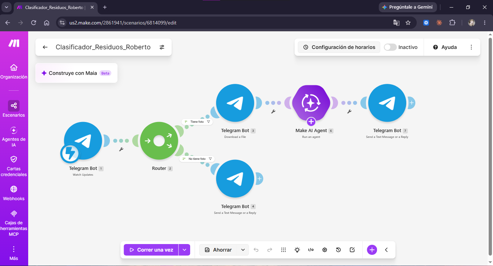

## 2. Arquitectura del escenario

```
Telegram Bot: Watch Updates
        │
     Router
   ┌────┴──────────────────────────┐
   │ Filtro "Tiene foto"           │ Filtro "No tiene foto"
   │ (message.photo existe)        │ (message existe y photo no)
   ▼                               ▼
Telegram: Download a File     Telegram: Send a Reply
   ▼                          ("Envíame la foto de un residuo...")
Make AI Agent (con visión)
   ▼
Telegram: Send a Reply (respuesta del agente)
```

| # | Módulo | Configuración |
|---|---|---|
| 1 | Telegram Bot → Watch Updates | Conexión con el token del bot (guardado solo en Make) y webhook vinculado con `setWebhook` |
| 2 | Router | Dos rutas con filtro |
| 3 | Telegram Bot → Download a File | File ID = `{{last(map(1.message.photo; "file_id"))}}` (Telegram envía cada foto en varios tamaños; `last()` toma la de mejor calidad) |
| 6 | Make AI Agent | Conexión *Make's AI Provider* · archivo = foto descargada (`{{3.fileOutput}}`) · Input = `Clasifica el residuo de la imagen.` · Instrucciones (ver abajo) |
| 7 | Telegram Bot → Send a Reply | Chat ID = Message → Chat → ID · Texto = respuesta del agente (`{{6.response}}`) |
| 4 | Telegram Bot → Send a Reply | Ruta alterna: pide al usuario que envíe una foto |

### Filtros del Router

| Ruta | Filtro | Condición |
|---|---|---|
| 1 (clasificar) | Tiene foto | `{{1.message.photo}}` existe |
| 2 (aviso) | No tiene foto | `{{1.message}}` existe y `{{1.message.photo}}` no existe |

Así el escenario solo clasifica cuando llega una foto, y a un mensaje de texto
le responde pidiendo la foto en lugar de fallar.

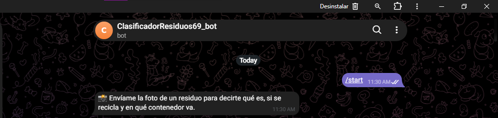

### Instrucciones del agente

El agente actúa como asesor de separación de residuos para alumnos del TecNM en
Mazatlán y responde siempre en texto plano, en español, con este formato:

```
Residuo: [qué es]
Material: [material principal]
Clasificación: [orgánico / inorgánico reciclable / inorgánico no reciclable / manejo especial o peligroso]
¿Se recicla?: [sí / no / depende, con una línea de explicación]
Dónde va: [contenedor o lugar de acopio]
Tiempo aproximado de degradación: [tiempo]
Consejo: [1 línea para reducir o reutilizar este residuo]
```

Además: debe describir solo lo que realmente se ve (sin inventar objetos); si hay
varios residuos, clasifica el que ocupa el centro y menciona brevemente los
demás en el consejo; si no distingue un residuo responde *"No pude identificar el
residuo, envía otra foto más clara."*; y si es peligroso (pilas, medicamentos,
aceite, químicos) lo indica y recomienda no tirarlo a la basura común.

El blueprint está en [`codigo/blueprint.json`](codigo/blueprint.json).

## 3. Investigación previa

### 3.1 ¿Cómo se clasifican los residuos en México?

La **Ley General para la Prevención y Gestión Integral de los Residuos (LGPGIR)**
(última reforma DOF 19-01-2026) distingue tres grandes categorías en su Art. 5:

- **Residuos sólidos urbanos (RSU):** los generados en las casas habitación por
  el consumo de productos y sus envases, embalajes o empaques; los de
  establecimientos o vía pública con características domiciliarias; y los de la
  limpieza de vías y lugares públicos (fracc. XXXIII).
- **Residuos de manejo especial (RME):** los generados en procesos productivos
  que no son peligrosos ni RSU, o los producidos por grandes generadores de RSU
  (fracc. XXX); el Art. 19 los clasifica en varias categorías.
- **Residuos peligrosos (RP):** los que tienen características de corrosividad,
  reactividad, explosividad, toxicidad, inflamabilidad o agentes infecciosos,
  más los envases y suelos contaminados (fracc. XXXII).

El **Art. 18** permite subclasificar los RSU en **orgánicos e inorgánicos** para
facilitar su separación primaria y secundaria, según los programas estatales y
municipales. De ahí sale la clasificación práctica que usa este bot:

| Categoría práctica | Qué incluye |
|---|---|
| Orgánico | Restos de comida, cáscaras, residuos de jardín |
| Inorgánico reciclable | Papel, cartón, vidrio, metales, ciertos plásticos |
| Inorgánico no reciclable | Residuos sin mercado de reciclaje común (por ejemplo, unicel o plásticos mezclados) |
| Manejo especial o peligroso | Pilas, medicamentos, aceites, químicos, electrónicos |

Fuente: LGPGIR, Arts. 5, 18 y 19 [1].

### 3.2 ¿Cómo se recolectan y separan en Mazatlán y a dónde llegan?

- **Quién recolecta.** La ley asigna a los **municipios** las funciones de manejo
  integral de los RSU: recolección, traslado, tratamiento y disposición final
  (LGPGIR, Art. 10). En Mazatlán lo atiende la Dirección de Servicios Públicos.
- **Cuánto se recolecta.** Según la directora de Servicios Públicos, en un día
  normal se recogen entre **670 y 700 toneladas** en la ciudad, y en la primera
  semana de vacaciones de Semana Santa de 2025 (13 al 20 de abril) fueron
  **6,800 toneladas**, de las cuales 1,100 en la zona turística. Es una
  declaración de una funcionaria publicada por un medio, no un informe oficial
  [4].
- **Separación.** En noviembre de 2020 el Ayuntamiento anunció una campaña para
  que los hogares separaran residuos **orgánicos e inorgánicos** desde enero de
  2021; la directora de Ecología dijo que sería obligatoria y que el personal de
  Aseo Urbano podría revolver los residuos al cargarlos [2]. No encontré una
  fuente que confirme si la separación domiciliaria sigue vigente hoy.
- **A dónde llegan.** Un reportaje de febrero de 2020 señala que el "basurón" de
  Mazatlán **no es un verdadero relleno sanitario** y que se analizaban
  alternativas, entre ellas remediar la basura acumulada y estudiar una
  propuesta de incineración [3]. No pude verificar el estado actual del relleno
  sanitario, así que conviene consultarlo con el Ayuntamiento antes de afirmar
  algo más reciente.

### 3.3 Tres datos sobre el impacto de los residuos en el mar de la región

1. **Playas.** El director de la Operadora y Administradora de Playas dijo en
   2021 que a diario se retiran de **200 a 300 kilos** de basura de las playas
   (bolsas, envases, latas, vidrio, cartón, unicel y popotes), y que esto
   contamina el mar [5].
2. **Limpieza masiva.** En junio de 2021, una limpieza de 4 km de playa con más
   de 800 participantes evitó que **1.4 toneladas** de basura llegaran al mar;
   lo más común fue vidrio, colillas de cigarro y plásticos de un solo uso [6].
3. **Microplásticos.** Un diagnóstico del Instituto de Ciencias del Mar y
   Limnología de la UNAM (muestras de diciembre de 2018 a enero de 2019) encontró
   de **1 a 10 partículas de microplástico por kilo de arena** en las playas
   Gaviotas y Olas Altas, y un promedio de **2.3 partículas por metro cúbico**
   de agua superficial en la bahía de Mazatlán y el Estero de Urías. Es poco
   comparado con otros lugares, pero muestra que el plástico ya está en el
   ambiente marino local. La misma nota recuerda que el 80 % del plástico en los
   océanos tiene origen continental [7].

## 4. Pruebas con 10 residuos

Se fotografiaron 10 residuos distintos del campus y de la casa y se enviaron al
bot. Cada captura muestra la foto y la respuesta del agente.

| 1. Bolsa de botana | 2. Envoltorio y caja de cartón en bolsa negra |
|---|---|
| 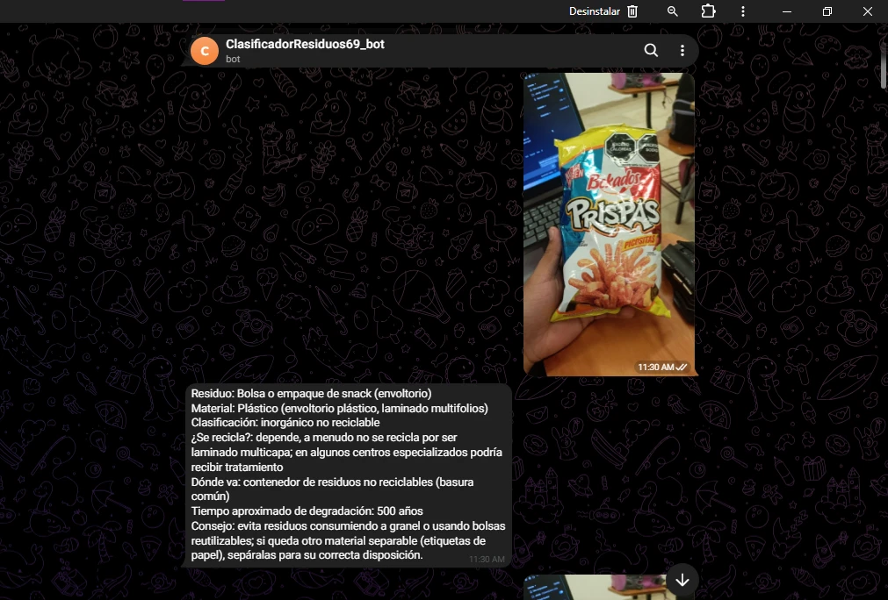 | 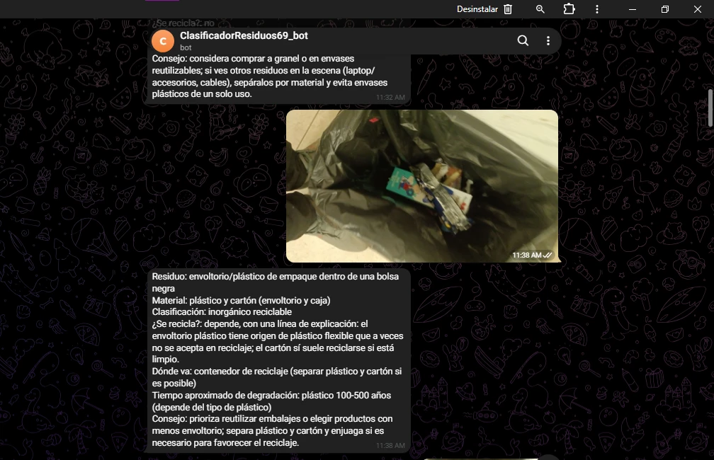 |
| **3. Bandeja roja de plástico** | **4. Bolsa de basura negra** |
| 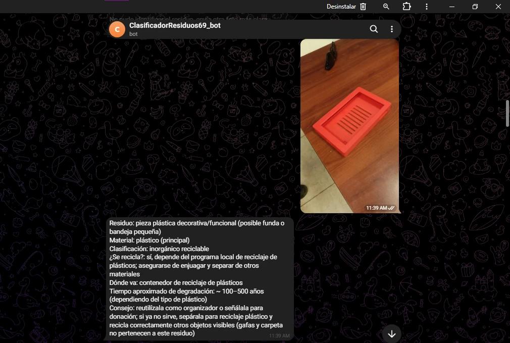 | 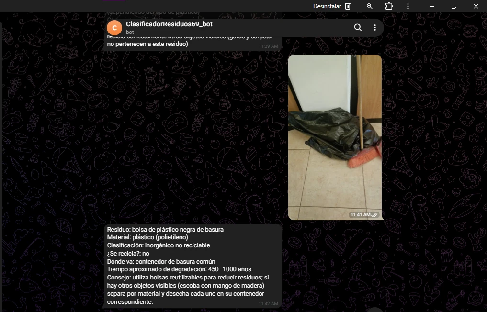 |
| **5. Cajas de plástico para almacenaje** | **6. Papel picado (adornos de papel)** |
| 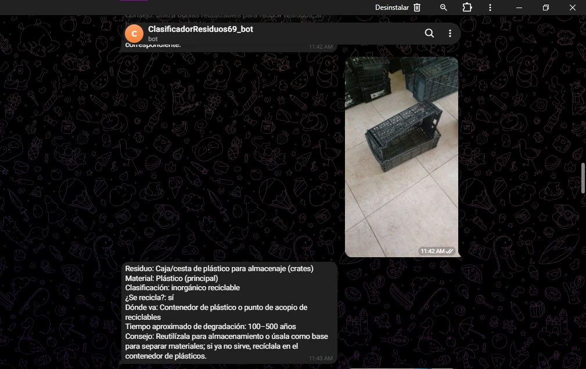 | 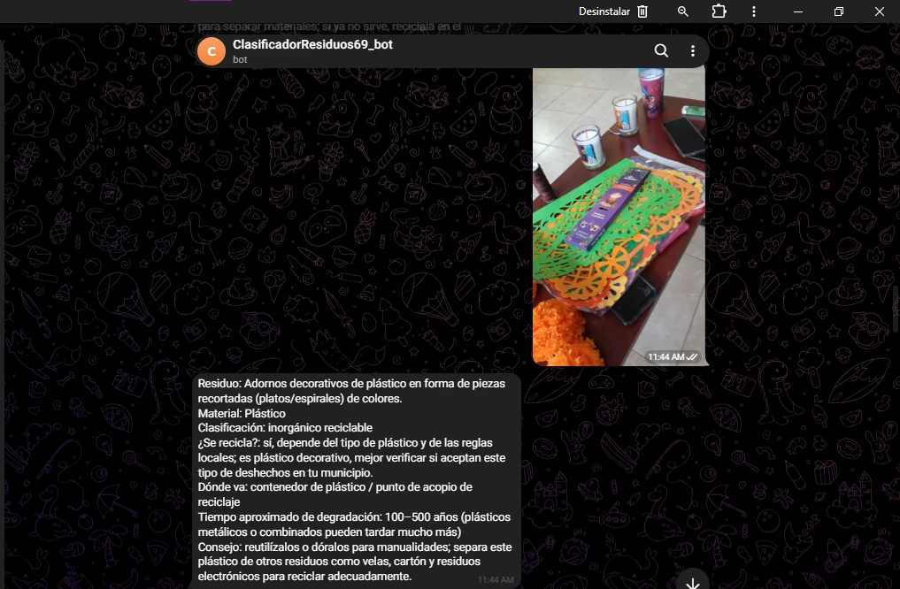 |
| **7. Palets de madera** | **8. Estaca de PVC para planta** |
| 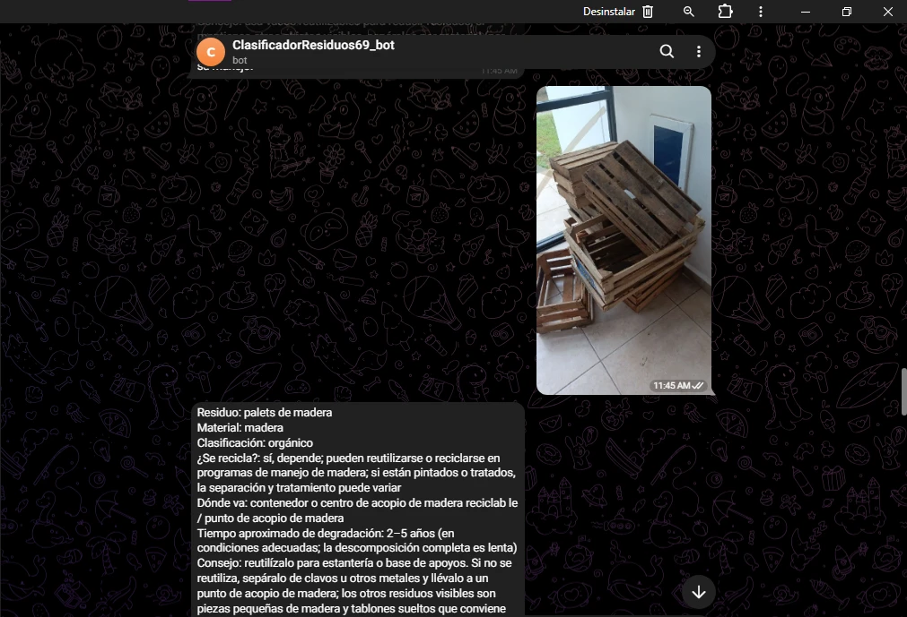 | 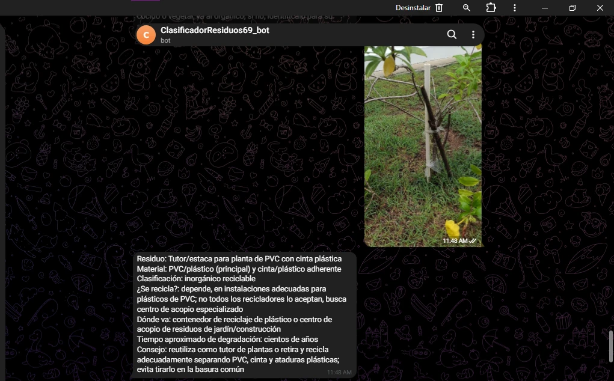 |
| **9. Tablón de madera** | **10. Botella de plástico** |
| 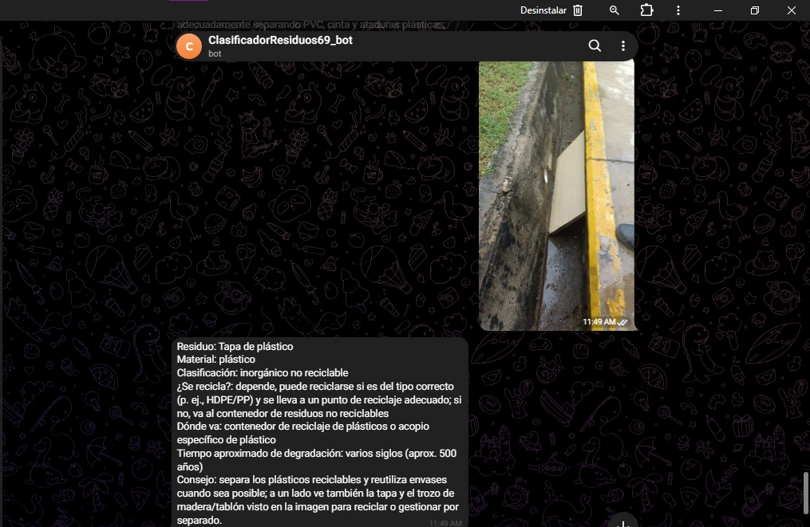 | 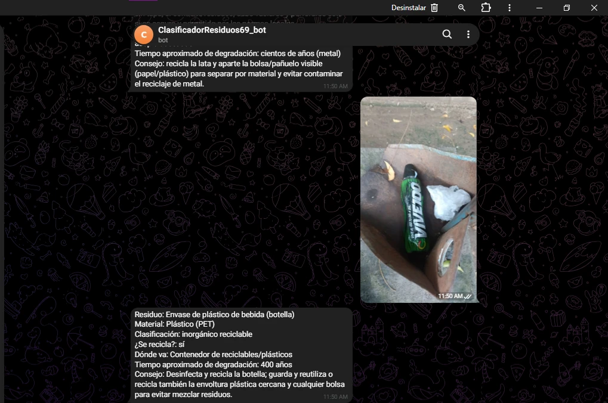 |

### 4.1 Verificación de la clasificación y del tiempo de degradación

Leyenda: ✅ coincide · ⚠️ parcial o discutible · ❌ no coincide · ➖ sin fuente verificada.

| # | Residuo (real) | Clasificación según la IA | ¿Correcta? | Tiempo según la IA | Tiempo según la fuente | Fuente |
|---|---|---|---|---|---|---|
| 1 | Bolsa de botana (empaque multicapa) | Inorgánico no reciclable | ✅ | 500 años | Bolsa de plástico: 20 años (estimación) ❌ | [D], [C] |
| 2 | Envoltorio plástico y caja de cartón | Inorgánico reciclable | ⚠️ El cartón sí; el envoltorio flexible es difícil de reciclar | Plástico: 100–500 años | Bolsa: 20 años; botella: 450; cartón: 2 meses ⚠️ | [D], [C] |
| 3 | Bandeja roja de plástico | Inorgánico reciclable | ✅ (material aceptado como lo identificó la IA) | 100–500 años | Jarra de plástico: 100 años; botella: 450 ✅ | [C] |
| 4 | Bolsa de basura negra | Inorgánico no reciclable | ➖ (solo consta que se fabrican de HDPE o LDPE) | 450–1000 años | Bolsa de plástico: 20 años ❌ | [A], [C] |
| 5 | Cajas de plástico para almacenaje | Inorgánico reciclable | ✅ probable (la resina no se confirmó; ECOCE maneja PET, HDPE y aluminio) | 100–500 años | Jarra de plástico (HDPE): 100 años ✅ | [D], [C] |
| 6 | **Papel** picado | Inorgánico reciclable (la IA lo creyó plástico) | ⚠️ Correcta por casualidad: el papel también es inorgánico reciclable | 100–500 años | Periódico: 6 semanas; cartón: 2 meses ❌ | [C] |
| 7 | Palets de madera | Orgánico | ⚠️ Discutible: es de origen vegetal, pero los palets se reutilizan o se trituran | 2–5 años | Madera contrachapada: 3 años ✅ | [B], [C] |
| 8 | Estaca de PVC | Inorgánico reciclable | ➖ (sin fuente sobre el reciclaje del PVC) | "Cientos de años" | Plásticos: 100 a 450 años ⚠️ | [C] |
| 9 | **Tablón de madera** (la IA dijo "tapa de plástico") | Inorgánico no reciclable | ❌ Era madera, no plástico | ~500 años | Madera contrachapada: 3 años ❌ | [C] |
| 10 | Botella de plástico | Inorgánico reciclable | ✅ | 400 años | Botella de plástico: 450 años ✅ | [A], [C] |

**Porcentaje de aciertos en la clasificación (10 pruebas):**

| Resultado | Pruebas | Porcentaje |
|---|---|---|
| ✅ Correcta | 1, 3, 5, 10 | 4 de 10 (**40 %**) |
| ⚠️ Parcial o discutible | 2, 6, 7 | 3 de 10 (30 %) |
| ❌ Incorrecta | 9 | 1 de 10 (10 %) |
| ➖ Sin fuente para verificar | 4, 8 | 2 de 10 (20 %) |

Sobre las 8 que se pudieron evaluar, **4 son totalmente correctas (50 %)** y 7
lo son al menos en parte (88 %). En el **tiempo de degradación**, la IA coincidió
con la fuente en 4 pruebas (3, 5, 7 y 10), en 2 de forma parcial (2 y 8) y no
coincidió en 4 (1, 4, 6 y 9).

### 4.2 Verificación de "¿Se recicla?"

| # | Según la IA | Según la fuente | ¿Coincide? |
|---|---|---|---|
| 1 | Depende; a menudo no, por ser laminado multicapa | Los envases flexibles y multicapa son difíciles de reciclar mecánicamente [D] | ✅ |
| 2 | Depende: el envoltorio a veces no se acepta; el cartón sí, si está limpio | Los flexibles son difíciles de reciclar [D]; del cartón no se verificó fuente | ✅ en el envoltorio |
| 3 | Sí, depende del programa local | Sin fuente verificada | ➖ |
| 4 | No | Sin fuente verificada | ➖ |
| 5 | Sí | ECOCE maneja envases de HDPE [D]; resina de las cajas sin confirmar | ✅ probable |
| 6 | "Sí, depende del tipo de plástico" | La IA razonó con el material equivocado (era papel) | ⚠️ |
| 7 | Sí, depende; programas de manejo de madera | En 2018 se recicló el 17.1 % de los palets en EE. UU., triturados para mantillo o cama de animales [B] | ✅ |
| 8 | Depende; no todos los recicladores aceptan PVC | Sin fuente verificada | ➖ |
| 9 | Depende (HDPE/PP) | La respuesta habla de plástico, pero era madera | ❌ |
| 10 | Sí | Se reciclaron el 29.1 % de las botellas y frascos de PET en EE. UU. en 2018 [A]; en México se cita un 64 % de recuperación de PET (cifra de un video de opinión, sin fuente en la página) [E] | ✅ |

### 4.3 Qué se observó

- **La IA acierta en empaques comunes** (botella de plástico, bolsa de botana) y
  da respuestas ordenadas y específicas.
- **Se equivocó al identificar el material en 2 de 10 fotos** (20 %): confundió
  el papel picado con plástico (6) y un tablón de madera con una tapa de
  plástico (9). Cuando el material está mal, también salen mal el
  "¿se recicla?", el contenedor y el tiempo de degradación, que dependen de él.
- En la prueba 9 la respuesta se contradice: clasifica como "inorgánico no
  reciclable" pero dice que "depende" y sugiere el contenedor de reciclaje.
- **Los tiempos de degradación de bolsas y películas** (cientos de años según la
  IA) **no coinciden** con la ficha consultada (20 años para una bolsa). Las
  fuentes advierten que son estimaciones muy inciertas, así que no se puede
  declarar a ninguna como la correcta.
- En fotos con varios objetos (por ejemplo, 3, 4, 6 y 9) el agente mencionó otros elementos de
  la escena en el consejo, como indican sus instrucciones.
- **Límite de la verificación:** para el PVC, para las bolsas de basura y para el
  reciclaje del papel no encontré una fuente que pudiera leer y verificar, así
  que esos datos quedan como "sin fuente verificada" en lugar de darlos por
  buenos. La ficha de tiempos de degradación es de una organización civil
  australiana (Tangaroa Blue); no es una fuente oficial.

### 4.4 Costo de una foto

Del historial del escenario, las 15 fotos enviadas durante la sesión de pruebas
(de las 11:30 a las 11:50, de las que 10 se documentan arriba) consumieron entre
**4.21 y 4.48 créditos** cada una, **≈ 4.4 créditos en promedio**, con 4
operaciones y unos 7.5 segundos por respuesta.

## 5. Video de la prueba en vivo

[Ver la prueba en YouTube](https://youtu.be/lsubzxvRTs8)

El enlace también está en [`video/enlace.txt`](video/enlace.txt).

## 6. Preguntas de reflexión

**1. ¿Cuántos de los 10 residuos se pueden reciclar o compostar? ¿Cuántos separan realmente en su casa?**
De los 10 residuos, **6 se pueden reciclar o reaprovechar** sin mayor problema (la
botella de plástico, las cajas y la bandeja de plástico, el papel picado, y la
madera de los palets y del tablón); **1 solo en parte** (la bolsa con cartón: el
cartón sí, el envoltorio plástico no) y **3 son difíciles o no se reciclan**
(el empaque multicapa de botana, la bolsa de basura y la estaca de PVC). En mi
casa casi no se separa nada: lo orgánico a veces se aprovecha como abono, pero lo
inorgánico se queda junto y no se clasifica, así que de estos 10 prácticamente
ninguno se separa hoy.

**2. ¿Qué residuo les sorprendió más por su tiempo de degradación? ¿Qué impacto tiene cuando llega al mar o a un canal de Mazatlán?**
Lo que más sorprende es la diferencia entre materiales: una botella de plástico
tarda unos 450 años en degradarse según la ficha consultada, mientras que la
madera de un palet o un tablón tarda cerca de 3 años y el papel, semanas o
meses. También me sorprendió que, con buenas instrucciones, la IA diera
respuestas tan específicas y ordenadas para cada foto. En el mar, los plásticos
no desaparecen: se fragmentan en microplásticos. En Mazatlán se retiran a diario
entre 200 y 300 kilos de basura de las playas [5], en una sola limpieza de 4 km
se evitó que 1.4 toneladas llegaran al mar [6], y la UNAM ya encontró
microplásticos en la arena y en el agua de la bahía y del Estero de Urías [7].

**3. ¿En qué casos se equivocó la IA? ¿A qué creen que se debió?**
Se equivocó al identificar el material en 2 de 10 fotos: en el **papel picado**
(6) lo tomó por plástico y en el **tablón de madera** (9) lo tomó por una tapa de
plástico; además clasificó la madera de los palets como "orgánico", lo cual es
discutible, y dio tiempos de degradación de bolsas muy distintos a la ficha
consultada. Creo que se debió a la foto y al contexto: en la del papel picado
había muchos objetos y colores brillantes (velas, flores, otros adornos) que se
parecen a un plástico, y en la del tablón la escena era oscura y el objeto
estaba parcialmente visible junto a un canal. Además, el agente no tiene
contexto local ni puede tocar el material. Aun así, en la mayoría de las pruebas
las respuestas fueron coherentes, así que el bot sirve como guía inicial siempre
que se revise lo que responde.

**4. ¿De quién es la responsabilidad de que un residuo se recicle: del ciudadano, del municipio o de la empresa que lo fabrica?**
La ley la reparte. El principio de **responsabilidad compartida** (LGPGIR,
Art. 5, fracc. XXXIV) reconoce que los residuos salen de actividades que
satisfacen necesidades de la sociedad, a lo largo de cadenas de valor
(producción, envasado, distribución y consumo), y que por eso su manejo es una
corresponsabilidad social. Al **ciudadano** le toca separar y entregar bien sus
residuos; al **municipio**, recolectar, trasladar, tratar y dar disposición final
a los RSU (Art. 10); y a la **empresa**, diseñar envases que puedan reciclarse y
participar en su recuperación. Ninguno puede hacerlo solo: si el ciudadano
separa pero el camión revuelve todo, el esfuerzo se pierde.

**5. ¿Qué cambio concreto harían en su consumo después de esta práctica?**
Hoy muchas empresas ya vieron el daño que sus productos hacen a los
ecosistemas y están cambiando algunos de ellos por versiones más naturales, como
los popotes. En mi caso, voy a seguir fijándome en qué se puede reciclar y qué
conviene desechar por separado o junto (por ejemplo, separar el plástico del
cartón en un empaque mixto) y a procurar que no se me pase, porque de vez en
cuando se me olvida.

## 7. Fuentes

**De la investigación previa**

1. Cámara de Diputados. *Ley General para la Prevención y Gestión Integral de los Residuos* (última reforma DOF 19-01-2026). https://www.diputados.gob.mx/LeyesBiblio/pdf/LGPGIR.pdf
2. Luz Noticias (28/11/2020). *Implementarán campaña de separación de basura en Mazatlán.* https://www.luznoticias.mx/2020-11-28/sinaloa/implementaran-campana-de-separacion-de-basura-en-mazatlan/104333
3. Luz Noticias (09/02/2020). *Analizan solución al basurón y manejo de residuos en Mazatlán.* https://www.luznoticias.mx/2020-02-09/sinaloa/analizan-solucion-al-basuron-y-manejo-de-residuos-en-mazatlan/82818
4. Tus Buenas Noticias (22/04/2025). *Jornada de limpieza en Mazatlán, recolectan 6,800 toneladas de basura en la primera semana de vacaciones.* https://www.tusbuenasnoticias.com/amp/noticias/sinaloa/2025/04/22/44219-mazatlan-recogen-6800-toneladas-de-basura
5. Luz Noticias (11/08/2021). *Playas de Mazatlán, con serios problemas de basura: OAP.* https://www.luznoticias.mx/2021-08-11/sinaloa/playas-de-mazatlan-con-serios-problemas-de-basura-oap/121981
6. Luz Noticias (12/06/2021). *Evitan que 1.4 t de basura llegue al mar con limpieza masiva de playas en Mazatlán.* https://www.luznoticias.mx/2021-06-12/sinaloa/evitan-que-14-t-de-basura-llegue-al-mar-con-limpieza-masiva-de-playas-en-mazatlan/117775
7. ICML-UNAM (abril de 2019). *Avanza estudio de microplásticos en Mazatlán.* https://www.icmyl.unam.mx/Pdf/Home/2019/nota.microplasticos.pdf

**De la verificación de las pruebas**

- **[A]** U.S. EPA. *Plastics: Material-Specific Data* (datos de 2018). https://www.epa.gov/facts-and-figures-about-materials-waste-and-recycling/plastics-material-specific-data
- **[B]** U.S. EPA. *Wood: Material-Specific Data* (datos de 2018). https://www.epa.gov/facts-and-figures-about-materials-waste-and-recycling/wood-material-specific-data
- **[C]** Tangaroa Blue / Australian Marine Debris Initiative. *Marine debris – how long until it's gone?* (ficha informativa). https://tangaroablue.org/wp-content/uploads/2021/12/Marine-Debris-How-Long-Till-It39s-Gone.pdf
- **[D]** Packaging Insights (08/01/2026). *Aduro Clean Technologies tackles flexible plastic waste in Mexico.* https://www.packaginginsights.com/news/aduro-expands-chemical-recycling-mexico.html
- **[E]** ADN40 (18/09/2025, sección de opinión). *México, líder en reciclaje de PET.* https://www.adn40.mx/videoteca-opinion/2025-09-18/reciclaje-del-plastico-en-mexico/
